<p align="center"></p>

# Kidney cancer, three layers at once: a multi-omics analysis in the LSMA Analysis Lab

**When gene activity, DNA methylation and mutations are measured in the same tumours, what do they say together, and does combining them tell us more than each one alone?**

This repository is a worked example from the **LSMA Analysis Lab**, the analysis platform of the [London School of Multiomics & AI](https://lsma.co.uk). The full analysis was run in the lab, without writing code: import of three public data layers for the same patients, how far the layers agree, links between layers, shared factors (MOFA), patient groups from all layers at once (similarity network fusion) with survival, a supervised model (DIABLO), and a comparison of all methods. The report, figures and tables it produced are here, with a robustness check and a comparison with known biology.

| | |
|---|---|
| **Data** | TCGA-KIRC (The Cancer Genome Atlas, clear cell kidney cancer): RNA-seq, DNA methylation (450K) and somatic mutations of the same tumours, from the NCI Genomic Data Commons |
| **Patients** | 100 primary tumours with all three layers (the lab imports at most 100 methylation arrays from TCGA) |
| **Layers** | expression (2,000 most variable genes), methylation (2,000 most variable CpG probes, after removing the sex chromosomes), mutations (32 genes mutated in at least 5 patients) |
| **Outcomes** | stage, vital status and survival time (30 deaths) |
| **Lab module** | Multi-omics integration (workflow version 1.0.0) |
| **Lab run time** | **5 min 41 s** for the whole analysis (importing and combining the three TCGA layers: about 4 min) |
| **Validation** | A robustness re-run with half the features (3 min 41 s), the published biology of ccRCC, and the companion [mutation analysis](https://github.com/MultiOmics-Intelligence/lsma-lab-somatic-mutations-kidney-cancer-tcga-kirc) |
| **Result** | Two patient groups with very different survival (log-rank p = 0.0006), reproduced with half the features. Combining the layers did not beat RNA alone, and the analysis led to a fix in the lab (see below) |

---

## Biological question and aim

**Question.** The companion repositories look at one molecular layer at a time. Here three layers of the same 100 tumours are analysed together. Do the layers agree about which patients are alike? Is there a shared pattern that runs through gene activity and methylation, and does it relate to how patients fare? And does integration add anything over the best single layer?

**Hypothesis.**
- Expression and methylation should agree strongly, because methylation helps switch genes on and off.
- A shared pattern should separate aggressive from less aggressive tumours, as reported by the TCGA consortium: higher stage, more methylation changes and worse survival.
- Mutations in *BAP1* should mark the more aggressive tumours, and *PBRM1* mutations the less aggressive.

**Aims**
1. Bring the three layers of the same patients together in the lab and check how far they agree.
2. Find links between single genes, methylation sites and mutations.
3. Find shared factors (MOFA) and patient groups (similarity network fusion), and relate them to stage and survival.
4. Test whether the layers can predict which patients died (DIABLO), with honest cross-validation.
5. Compare integration with each layer alone.
6. Check the results with fewer features and against known biology.

---

## Background: why combine layers?

Each layer tells a different part of the story:
- **Gene expression** (RNA) shows what the cell is doing now.
- **DNA methylation** marks the DNA in a way that keeps genes on or off for long periods.
- **Mutations** are the permanent DNA changes that drove the cancer.

**Multi-omics integration** asks what the layers say together. The lab offers several methods, because they ask different questions:
- **MOFA** finds hidden *factors*: patterns of variation, each shared by some or all of the layers.
- **Similarity network fusion (SNF)** builds a network of similar patients from each layer, fuses the networks and splits the patients into groups.
- **DIABLO** is told a known grouping (here, patients who died vs those alive) and looks for a small set of features in each layer that predicts it.

**Integration is not automatically better.** A single strong layer can carry most of the signal, and the lab's comparison stage is built to show that honestly.

---

## Key findings

1. **Expression and methylation agree; mutations stand apart** (Figure QC5). The distances between patients correlate at Mantel r = 0.53 for expression and methylation (p = 0.002), but only 0.04–0.07 between mutations and the other layers. Mutations are sparse: most tumours carry only a few of the 32 recurrent genes.
2. **One shared factor follows outcome** (Figures 1–3).
   - **MOFA found 6 factors, 5 shared between layers.** They explain 43% of the variation in expression and 37% in methylation, but little of the sparse mutation layer.
   - **Factor 1 relates to death and to stage** (R² = 0.22 with vital status, 0.16 with stage). It is lower in patients who died (mean −1.19 vs +0.51) and falls step by step from stage I to stage IV.
   - **Its genes are kidney metabolism genes**, high in the less aggressive tumours: *HAO2*, *CYP4A11*, *GLYATL1*, *ACADL*, *SLC27A2*, *AGTR1*, *NPR3*. At its other end are genes of aggressive disease such as *GFPT2*, *LAMB3* and *BASP1*. This resembles the known split of ccRCC into a better (ccA) and a worse (ccB) subtype.
3. **Two patient groups with very different survival** (Figure 4).
   - SNF divided the patients into two groups, 66 and 34 patients.
   - **The smaller group did much worse:** 18 of 34 patients died (53%), against 12 of 66 (18%); log-rank p = 0.0006. It also holds more stage III and IV tumours (17 of 29 staged patients, against 12 of 58).
4. **The layers predict death better than chance, but not well** (Figures 7–9).
   - **DIABLO's balanced error is 28%.** With shuffled labels it is 49% (permutation p = 0.02).
   - **Its mutation features point to the expected genes.** *BAP1*, *ZFHX4*, *MUC16* and *KMT2C* mutations carry weight towards death. *BAP1* and *ZFHX4* were also the genes most enriched in patients who died in the [mutation analysis](https://github.com/MultiOmics-Intelligence/lsma-lab-somatic-mutations-kidney-cancer-tcga-kirc).
5. **Integration did not beat RNA alone** (Figure 10). Asked to split the patients into two groups, RNA alone matches vital status best (adjusted Rand index 0.18). SNF comes close (0.17), and MOFA and canonical correlation follow (0.16), while pasting the layers together does worse (0.14). The lab says so in a warning. This is an honest and common result: in ccRCC, much of the prognostic signal is already in gene expression.
6. **Links between layers** (Figures 12–13).
   - 376 of 10,000 tested gene–methylation pairs correlate (adjusted p < 0.05).
   - *PBRM1* mutation goes with higher expression of the kidney tubule genes *ENPP3*, *SCGN* and *SLC17A3* (adjusted p = 0.002), consistent with PBRM1-mutant tumours being the less aggressive, more differentiated type.

Evidence labels from the lab: layer agreement, associations, survival and the DIABLO error are *statistically supported*; factors and groups are *exploratory*; their biological reading is *interpretation*.

---

## A fix in the lab, found by this analysis

The first run of this analysis gave a result that looked strong but was wrong. MOFA's first factor was the patients' **sex** (R² = 0.98), and the patient groups followed sex too.
- **The cause:** the methylation layer kept CpG probes on the X and Y chromosomes. 1,824 of the 5,000 most variable probes were on the sex chromosomes, and they differ between women and men far more than any tumour biology. The lab's own methylation workflow removes them in its quality control, but the multi-omics module didn't.
- **A second bug:** the DIABLO stage stopped with an error. In cross-validation, a gene mutated in only a few patients can have no carrier left among the training patients of a fold.

Both were fixed in the lab's code, and the results in this repository come from the corrected run:
- The multi-omics module now removes sex-chromosome probes from methylation layers (a new setting, on by default).
- DIABLO now drops such genes within a fold instead of stopping.

The fix is now live in the lab (25 November 2026), so students get the same corrected behaviour. The before-and-after comparison is in the Validation section. This is the purpose of the series: running real data from start to finish finds the weak points, and the fixes reach every student.

---

## Quality control and PCA

| Check | Result |
|---|---|
| Patients | 200 with RNA and mutations, 100 with methylation; **100 in every layer** (Figure QC2) |
| Features | expression 5,000 → 2,000 most variable genes; methylation 5,000 → 1,824 sex-chromosome probes removed → 2,000 most variable; mutations 154 genes → 32 mutated in at least 5 and absent in at least 5 patients (Figure QC1) |
| Missing values | none: the combined layers contain only features measured in every patient |
| Clinical data | stage missing for 13 patients; survival time and vital status complete |

**PCA of each layer (Figures QC3–QC4).**
- **Methylation:** PC1 (17% of all variation) moves from stage I tumours on one side to stage III and IV tumours on the other, the methylation–stage link reported by TCGA. The blue points without a stage label are the 13 patients with stage missing.
- **Expression:** shown the same way in Figure QC3.

| | |
|---|---|
| 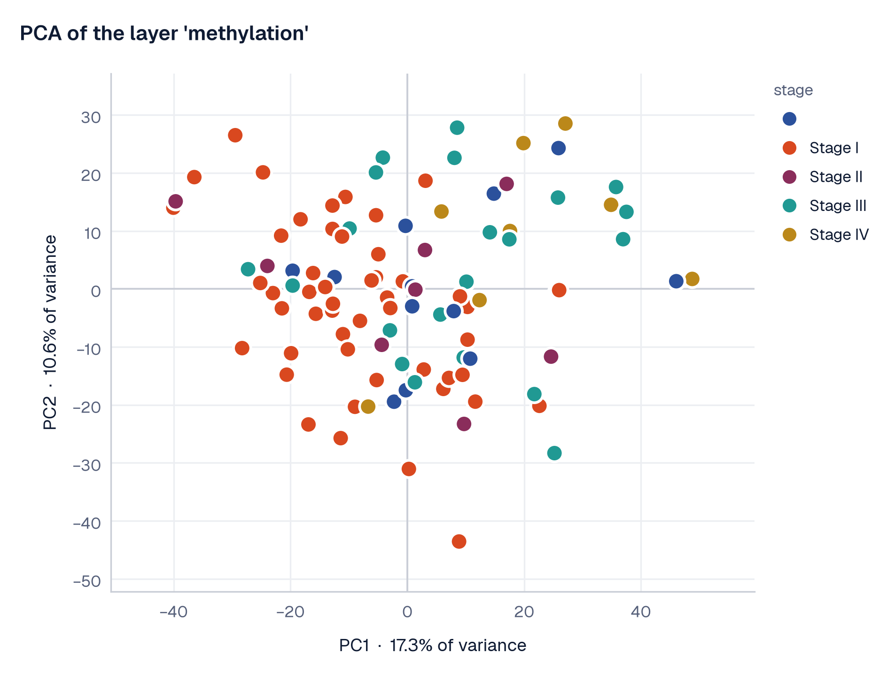 **QC4.** PCA of the methylation layer, coloured by stage. | 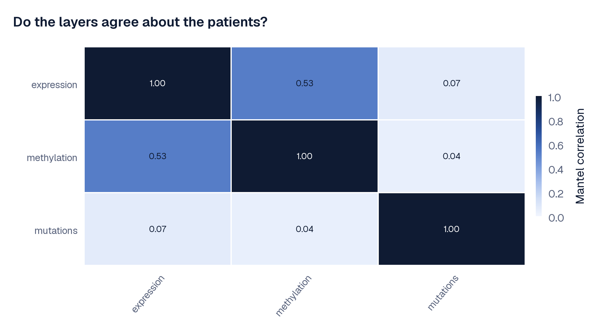 **QC5.** Do the layers agree about the patients? Mantel correlation of patient distances. |
| 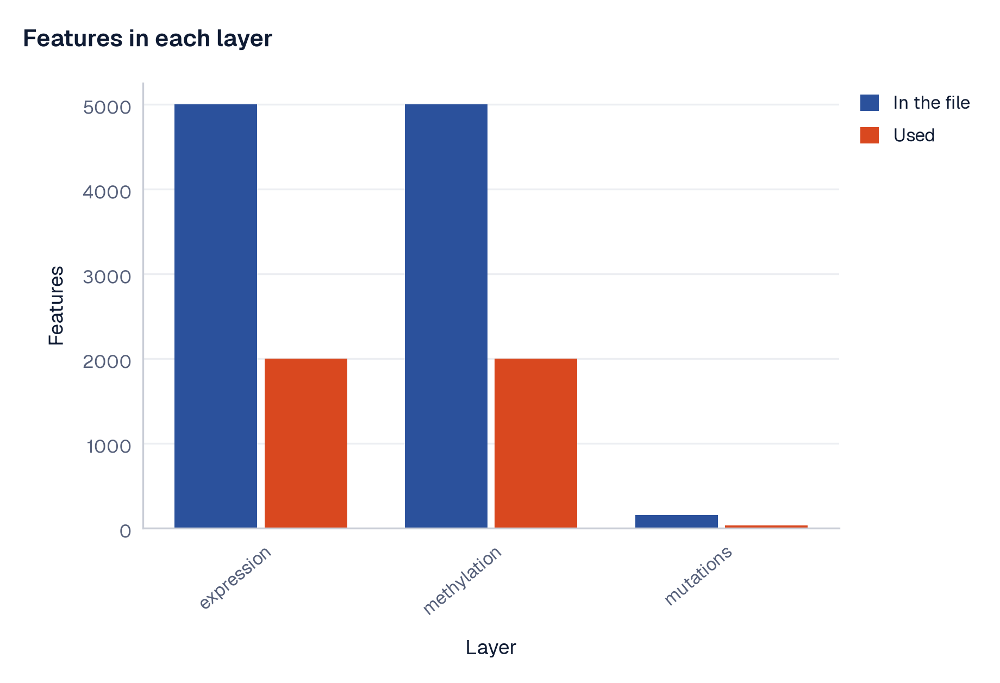 **QC1.** Features in each layer, in the file and used. | 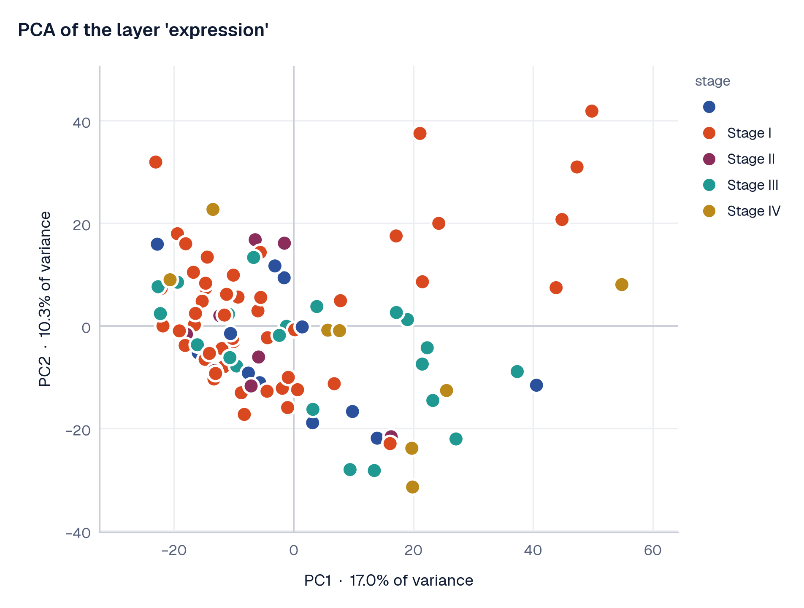 **QC3.** PCA of the expression layer, coloured by stage. |

Patients per layer (QC2) are in [`figures/`](figures).

---

## Figures

| | |
|---|---|
| 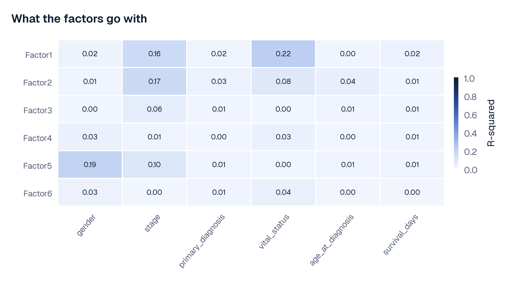 **Figure 2.** What the MOFA factors go with: factor 1 with vital status and stage. | 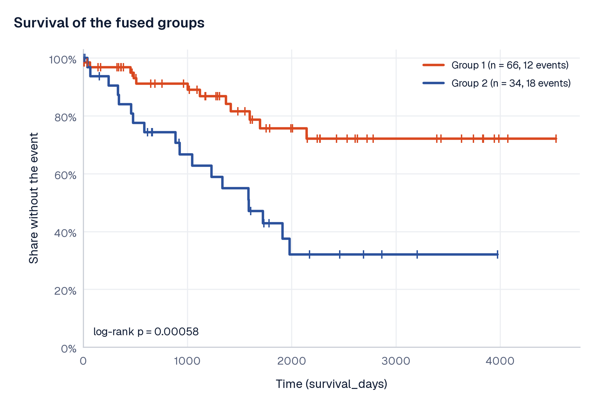 **Figure 4.** Survival of the two SNF patient groups (log-rank p = 0.0006). |
| 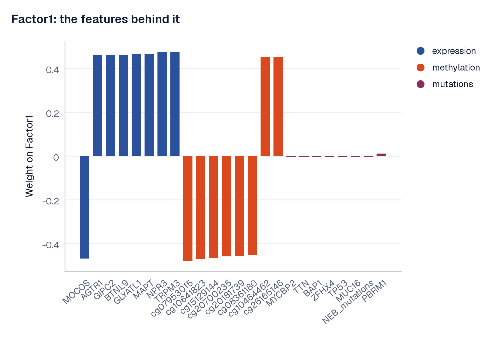 **Figure 3.** The features behind factor 1 in each layer. | 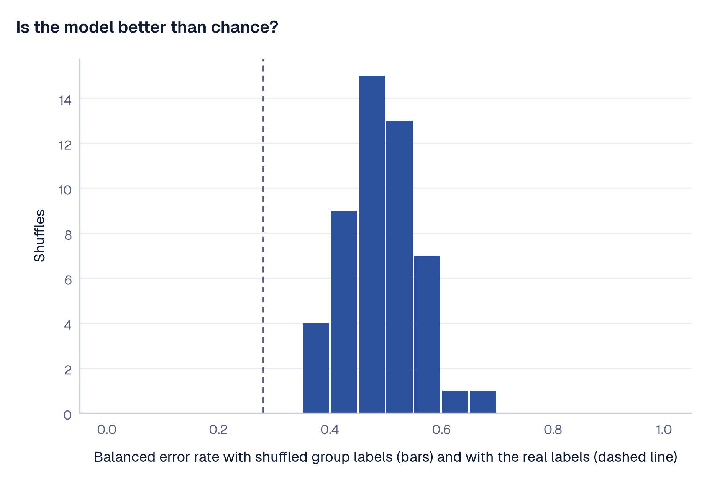 **Figure 8.** DIABLO with real labels (dashed line) against shuffled labels (bars). |
| 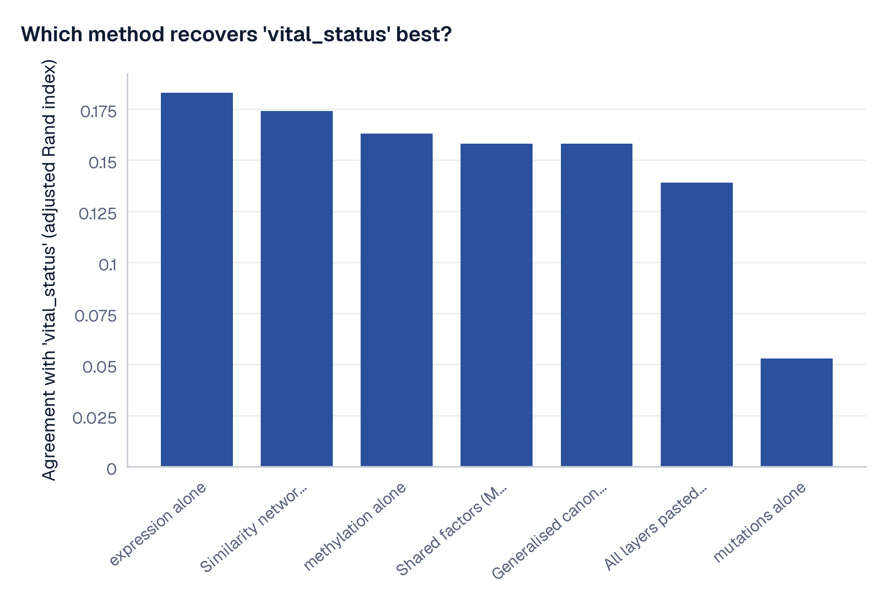 **Figure 10.** Which method recovers vital status best? RNA alone. | 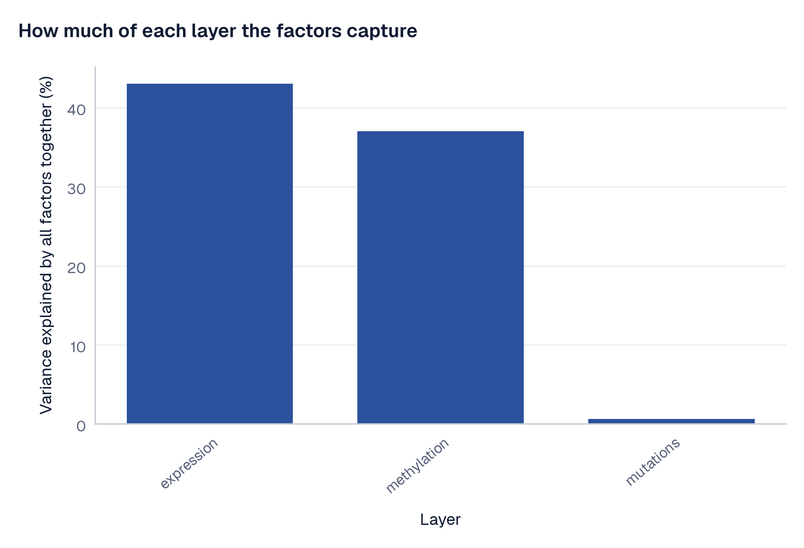 **Figure 1.** How much of each layer the factors capture. |

All figures are in [`figures/`](figures), as PNG (300 dpi) and vector PDF:

| File | What it shows |
|---|---|
| 01 | Variance of each layer captured by the MOFA factors |
| 02 | MOFA factors and the clinical data |
| 03 | Features behind factor 1 |
| 04 | Survival of the SNF patient groups |
| 05 | Patient map of the fused network |
| 06 | How close each layer alone comes to the fused groups |
| 07 | DIABLO cross-validated error |
| 08 | DIABLO against shuffled labels |
| 09 | DIABLO features on component 1 |
| 10 | Which method recovers vital status best |
| 11 | How far the methods agree with each other |
| 12 | Gene–methylation correlations |
| 13 | Strongest mutation–expression links |
| qc-pca-* | Layers, patients, PCA per layer and layer agreement |

## The full report

The lab's own report covers every stage: what was done, why, the checks, the results and their limits. It's available as a [**PDF**](report/LSMA-Analysis-Lab-report-kidney-cancer-multi-omics.pdf) or as [**HTML**](report/LSMA-Analysis-Lab-report-kidney-cancer-multi-omics.html) (download it and open it in a browser for the interactive version).

## Summary tables ([`results/`](results))

| File | Contents |
|---|---|
| `layer_summary.tsv` | Each layer: patients, features in the file, features used, sex-chromosome probes removed |
| `layer_agreement_mantel.tsv` | Mantel correlation between the layers |
| `cross_layer_feature_pairs.tsv` | Gene–methylation correlations and mutation–feature tests, with adjusted p-values |
| `mofa_factor_values.tsv` | Each patient's value on each MOFA factor |
| `mofa_factors_and_clinical.tsv` | How strongly each factor relates to each clinical column |
| `mofa_top_weights.tsv` | The features with the largest weights on each factor |
| `snf_patient_groups.tsv` | Each patient's SNF group, and the group from each layer alone |
| `snf_groups_and_clinical.tsv` | SNF groups against vital status, stage, sex and diagnosis |
| `diablo_selected_features.tsv` | The features DIABLO chose in each layer |
| `diablo_agreement_of_layers.tsv` | How far the layers' DIABLO components agree |
| `methods_compared.tsv` | Every method's grouping against pasting the layers together and against vital status |

---

## Workflow

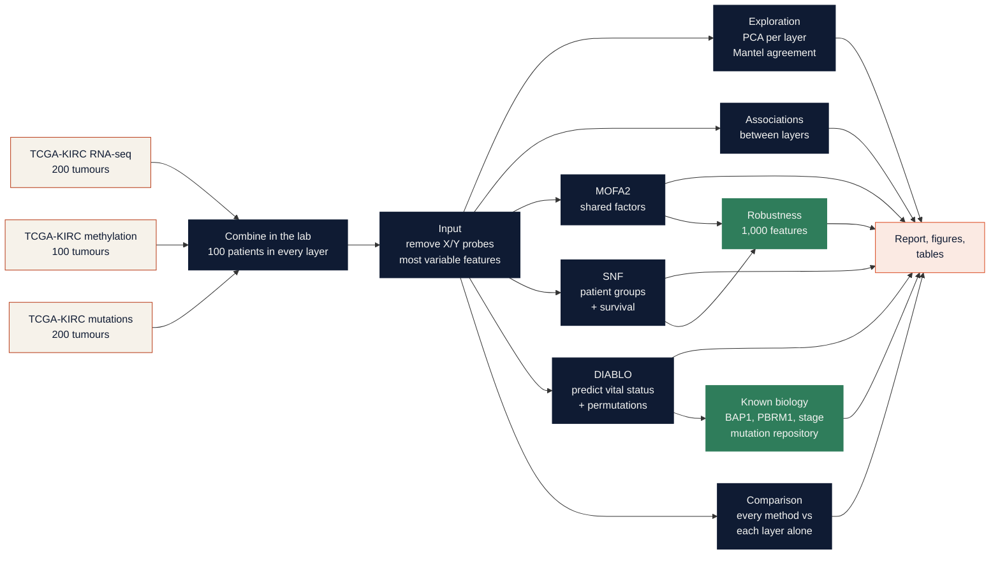

## How it was done

Every step below is a stage in the LSMA Analysis Lab, run with the settings in [`settings/analysis-settings.json`](settings/analysis-settings.json).

1. **Import.**
   - The mutation data of 200 TCGA-KIRC tumours were imported first (from the [mutation analysis](https://github.com/MultiOmics-Intelligence/lsma-lab-somatic-mutations-kidney-cancer-tcga-kirc)).
   - RNA-seq and methylation were then imported asking for **the same patients**, as the lab allows for multi-omics. The lab imports up to 100 methylation arrays from TCGA.
2. **Combine.** The lab combined the three datasets into one multi-omics dataset, linking them by patient. It used:
   - expression as log2 counts per million (genes above 1 CPM in 20% of samples, the 5,000 most variable);
   - methylation as beta values (the 5,000 most variable probes);
   - mutations as 1 or 0 per gene (genes mutated in at least 3 patients).
3. **Input.** Patients in every layer were kept, and sex-chromosome probes removed from the methylation layer. Then the 2,000 most variable features of each continuous layer were kept, and mutated genes with at least 5 carriers and 5 non-carriers.
4. **Exploration.** PCA of each layer, and the Mantel correlation (Spearman, permutation p-value) between the patient distances of each pair of layers.
5. **Associations.** Spearman correlation between the 100 most variable genes and methylation probes, and the Wilcoxon test between mutated genes and the continuous layers. Benjamini–Hochberg correction was applied within each pair of layers.
6. **Factors.** MOFA2 with up to 8 factors, keeping those explaining at least 1% of variation, and their association with the clinical columns.
7. **Clustering.** Similarity network fusion (20 neighbours, σ = 0.5, 20 iterations), spectral clustering with the number of groups by the eigengap rule, and a log-rank test of survival between groups.
8. **Supervised.** DIABLO (block sparse PLS-DA) for vital status: 2 components, 15 features per layer and component, 5-fold cross-validation repeated 10 times, and 50 shuffles of the labels.
9. **Comparison.** The same patients grouped by each layer alone, by pasting the layers together, by SNF, by MOFA factors and by generalised canonical correlation (RGCCA). Each grouping is compared with the others and with vital status.

**Software:** R 4.5.2 and Bioconductor 3.21, with MOFA2 (mofapy2), SNFtool, mixOmics, cluster and survival, in the versions listed in the settings file.

## The mathematics behind the methods

The formulas below are the ones the lab's code applies, with the settings of this run. $n = 100$ patients and $m = 3$ layers.

**Distances between patients.** Used by the Mantel test and by SNF.

$$
d_{ij} = \frac{1}{\sqrt{p}} \left\lVert z_i - z_j \right\rVert_2, \qquad z_{fi} = \frac{x_{fi} - \bar{x}_f}{s_f}
$$

Each feature $f$ of a layer is standardised to mean 0 and standard deviation 1, and $d_{ij}$ is the Euclidean distance between patients $i$ and $j$ over the layer's $p$ features, scaled so that a layer with more features does not give larger distances.

**Mantel test.** Do two layers agree about which patients are alike?

$$
r_M = \mathrm{Spearman}\left( d^{(a)}_{ij},\  d^{(b)}_{ij} \right)_{i<j}, \qquad p = \frac{b + 1}{B + 1}
$$

$r_M$ is the Spearman correlation between the patient distances of layers $a$ and $b$, over all pairs of patients. For the p-value the patients of one layer are shuffled $B = 499$ times, and $b$ counts the shuffles with a correlation at least as large as the real one.

**Associations between layers.** For two continuous layers, the Spearman correlation $r$ of every pair of features is tested with

$$
t = r \sqrt{\frac{n - 2}{1 - r^2}}
$$

on $n - 2$ degrees of freedom. For a mutated gene against a continuous feature, the Wilcoxon rank-sum test compares the patients with and without the mutation. P-values are corrected by Benjamini–Hochberg within each pair of layers.

**MOFA factors.**

$$
Y^{(m)} = Z  W^{(m)\top} + \varepsilon^{(m)}, \qquad R^2_{m,k} = 1 - \frac{\sum_{i,f} \left( y^{(m)}_{if} - z_{ik}  w^{(m)}_{fk} \right)^2}{\sum_{i,f} \left( y^{(m)}_{if} \right)^2}
$$

$Y^{(m)}$ is layer $m$ (patients by features), $Z$ holds the patients' values on the shared factors and $W^{(m)}$ the weights of each feature on them; $\varepsilon^{(m)}$ is the noise. Expression and methylation are standardised and modelled as Gaussian; the yes/no mutation layer uses a Bernoulli likelihood, in which the factors set the log-odds of a mutation. $R^2_{m,k}$ (shown for the centred continuous layers) is the share of layer $m$ explained by factor $k$; factors explaining less than 1% were dropped during training. Each factor is then linked to the sample sheet by the $R^2$ of a linear model or ANOVA, with Benjamini–Hochberg correction.

**Similarity network fusion (SNF).** Each layer first becomes a network of patients:

$$
W_{ij} = \frac{1}{\sigma \varepsilon_{ij} \sqrt{2\pi}} \exp\left( -\frac{d_{ij}^2}{2\sigma^2 \varepsilon_{ij}^2} \right), \qquad \varepsilon_{ij} = \frac{\bar{d}_i + \bar{d}_j + d_{ij}}{3}
$$

$`\bar{d}_i`$ is the mean distance of patient $i$ to its $K = 20$ nearest neighbours and $\sigma = 0.5$, so the kernel adapts to how crowded each patient's neighbourhood is. Each $W$ is normalised to $P$ ($`P_{ii} = 1/2`$, the rest of each row summing to $1/2$), and $S$ keeps only each patient's $K$ nearest neighbours. The layers then exchange information for $t = 20$ rounds:

$$
P^{(v)} \leftarrow S^{(v)} \left( \frac{1}{m - 1} \sum_{k \ne v} P^{(k)} \right) S^{(v)\top}
$$

with $P^{(v)}$ normalised again after each round. The fused network is the average of the $P^{(v)}$, normalised once more.

**Spectral clustering and the eigengap rule.**

$$
L = I - D^{-1/2} W D^{-1/2}, \qquad \hat{k} = \underset{k \in \lbrace 2, \dots, 8 \rbrace}{\arg\max} \left( \lambda_{k+1} - \lambda_k \right)
$$

$W$ is the fused network, $D$ the diagonal matrix of its row sums and $\lambda_1 \le \lambda_2 \le \dots$ the eigenvalues of the normalised Laplacian $L$. A large gap after $\lambda_k$ suggests $k$ groups. The patients are then grouped using the first $\hat{k}$ eigenvectors. The silhouette $s(i) = (b_i - a_i)/\max(a_i, b_i)$, where $a_i$ and $b_i$ are the mean distances of patient $i$ to its own group and to the nearest other group, measures how clearly the groups separate.

**Log-rank test.** For two groups,

$$
\chi^2 = \frac{\left( \sum_t (O_{1t} - E_{1t}) \right)^2}{\sum_t V_t}, \qquad E_{1t} = d_t \frac{n_{1t}}{n_t}, \qquad V_t = \frac{n_{1t}  n_{2t}  d_t  (n_t - d_t)}{n_t^2  (n_t - 1)}
$$

At each time of death $t$, $n_t$ patients are still followed ($n_{1t}$ and $n_{2t}$ in each group), $d_t$ die, and $O_{1t}$ of the deaths are in group 1. $\chi^2$ is compared with a chi-squared distribution on 1 degree of freedom.

**DIABLO (block sparse PLS-DA).** For each component,

$$
\max_{a_1, \dots, a_4} \sum_{i < j} c_{ij} \mathrm{cov}\left( X_i a_i,\  X_j a_j \right) \quad \text{subject to} \quad \lVert a_i \rVert_2 = 1, \ \  \lVert a_i \rVert_1 \le \lambda_i
$$

$X_1, X_2, X_3$ are the three layers and $X_4$ is the outcome (vital status, coded as indicator columns). $c_{ij} = 0.1$ between two layers and $c_{ij} = 1$ between a layer and the outcome, so the model favours separating the groups over agreement between layers. The L1 limit $\lambda_i$ is set so that 15 features per layer have a non-zero weight. RGCCA in the comparison maximises the same kind of sum with all layers linked ($c_{ij} = 1$), no outcome and no sparsity.

**Balanced error rate and its permutation p-value.**

$$
\text{BER} = \frac{1}{G} \sum_{g=1}^{G} \frac{\text{errors in group } g}{n_g}, \qquad p = \frac{b + 1}{B + 1}
$$

The BER is the mean of the error rates of the $G = 2$ groups, so the larger group cannot hide errors in the smaller one; it is measured by 5-fold cross-validation repeated 10 times, at the better of the two components. The labels were shuffled $B = 50$ times, and $b$ counts the shuffles whose best BER is at least as low as the real one.

**Adjusted Rand index.** How alike two groupings of the same patients are.

$$
\text{ARI} = \frac{\sum_{ij} \binom{n_{ij}}{2} - E}{\tfrac{1}{2}\left( \sum_i \binom{a_i}{2} + \sum_j \binom{b_j}{2} \right) - E}, \qquad E = \frac{\sum_i \binom{a_i}{2} \sum_j \binom{b_j}{2}}{\binom{n}{2}}
$$

$n_{ij}$ counts the patients in group $i$ of one grouping and group $j$ of the other, and $a_i$ and $b_j$ are the group sizes. The index is 1 for identical groupings and about 0 for agreement no better than chance.

---

## Validation

### 1. Before and after the lab fix
The same data were run before and after the fix to the multi-omics module ([`validation/before_and_after_the_lab_fix.tsv`](validation/before_and_after_the_lab_fix.tsv); the earlier factor heatmap is in [`validation/before-fix-factors_and_sample_sheet.png`](validation/before-fix-factors_and_sample_sheet.png)):

| Check | Before (sex-chromosome probes kept) | After (removed) |
|---|---|---|
| MOFA factor 1, R² with sex | **0.98** | 0.02 |
| MOFA factor 1, R² with vital status | 0.00 | **0.22** |
| SNF groups vs sex (adjusted Rand index) | 0.30 | −0.01 |
| Number of SNF groups | 4 | 2 |
| DIABLO stage | failed | completed |

### 2. Robustness: half the features
The analysis was run again in the lab keeping 1,000 instead of 2,000 features per continuous layer (3 min 41 s; [`validation/robustness_1000_features.tsv`](validation/robustness_1000_features.tsv)):

| Measure | 2,000 features | 1,000 features |
|---|---|---|
| MOFA factor 1 (correlation between the runs) | | **r = 0.99** |
| MOFA factor 2 (correlation between the runs) | | **r = 0.99** |
| SNF groups (eigengap rule) | 2 | 3 (the 2-group split, with the larger group divided; adjusted Rand index 0.55) |
| Survival difference between SNF groups | p = 0.0006 | p = 0.00006 |
| DIABLO balanced error (permutation p) | 0.28 (0.02) | 0.28 (0.02) |

The factors and the survival difference are stable. The exact number of groups is not, as the lab's low silhouette width (0.05) warns: the patients form a continuum more than separate types.

### 3. Known biology
- ***BAP1* towards death, *PBRM1* towards survival.** BAP1 loss marks aggressive ccRCC and PBRM1 loss the less aggressive form (TCGA 2013; Kapur et al. 2013). Here DIABLO gives *BAP1* a strong weight towards death, and *PBRM1* mutation goes with the more differentiated tubule genes.
- **The same genes as the mutation analysis.** *BAP1* and *ZFHX4* were the genes most enriched in patients who died in the [mutation analysis](https://github.com/MultiOmics-Intelligence/lsma-lab-somatic-mutations-kidney-cancer-tcga-kirc) (200 tumours). DIABLO picks both, from mutations alone.
- **Methylation follows stage.** The TCGA consortium reported more methylation changes in higher-stage tumours. Here methylation PC1 separates stage III and IV tumours from stage I (Figure QC4).
- **A metabolic factor.** Factor 1 is carried by kidney metabolism genes that aggressive tumours lose. This fits the metabolic shift found in the [proteomics](https://github.com/MultiOmics-Intelligence/lsma-lab-proteomics-kidney-cancer-cptac) and [metabolomics](https://github.com/MultiOmics-Intelligence/lsma-lab-metabolomics-kidney-cancer) analyses.

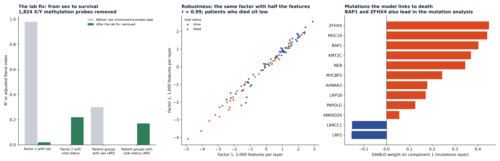

**Figure V1.**
- **Left:** before and after the lab fix.
- **Middle:** MOFA factor 1 with 2,000 and with 1,000 features per layer, coloured by vital status.
- **Right:** the mutations DIABLO links to death or survival.

**Verdict: robust for the factors and the survival difference; integration adds little over RNA alone.**

---

## Limitations

- **100 patients.** The lab imports at most 100 TCGA methylation arrays, so the integration uses 100 of the 200 tumours. Groups and factors from 100 patients are less stable than from several hundred, and there was no independent cohort with all three layers to repeat the analysis in.
- **Vital status is a crude outcome.** "Died vs alive at last follow-up" ignores how long each patient was followed. The survival test of the SNF groups uses the follow-up time; DIABLO does not.
- **Sex genes remain in the expression layer.** Only methylation probes on the sex chromosomes are removed. Genes such as *XIST* and *RPS4Y1* still vary with sex, and MOFA factor 5 relates to sex (R² = 0.19).
- **Mutations add little to the integrated methods.** With 32 sparse genes, the mutation layer contributes under 1% of the variation the factors capture. Its signal shows mainly in DIABLO.
- **Groups are a continuum.** The silhouette width of 0.05 says the patients do not fall into sharply separate groups. Two or three groups are equally defensible.
- **A teaching example, not clinical advice.** These results are for education and must not be used to diagnose or treat anyone.

---

## Repository structure

```
lsma-lab-multi-omics-kidney-cancer-tcga-kirc/
├── README.md                  this case study
├── LICENSE                    CC BY 4.0
├── assets/
│   └── lsma-lab-kidney-multi-omics-banner.svg   animated banner
├── report/                    the LSMA Analysis Lab's full report
│   ├── LSMA-Analysis-Lab-report-kidney-cancer-multi-omics.pdf
│   └── LSMA-Analysis-Lab-report-kidney-cancer-multi-omics.html
├── figures/                   key figures, PNG (300 dpi) and vector PDF
│   ├── 01-variance_per_layer ... 13-strongest_expression_mutations
│   └── qc-pca-*                                layers, patients, PCA, agreement
├── results/                   summary tables (tab-separated)
│   ├── layer_summary.tsv, layer_agreement_mantel.tsv, cross_layer_feature_pairs.tsv
│   ├── mofa_factor_values.tsv, mofa_factors_and_clinical.tsv, mofa_top_weights.tsv
│   ├── snf_patient_groups.tsv, snf_groups_and_clinical.tsv
│   ├── diablo_selected_features.tsv, diablo_agreement_of_layers.tsv
│   └── methods_compared.tsv
├── validation/                the lab fix, robustness and known biology
│   ├── validation-fix-robustness-and-known-biology.png / .pdf
│   ├── before-fix-factors_and_sample_sheet.png
│   ├── before_and_after_the_lab_fix.tsv
│   └── robustness_1000_features.tsv
└── settings/
    └── analysis-settings.json          every parameter and software version
```

## Why we share this analysis

This is one of a series of worked examples from the **LSMA Analysis Lab**, published openly for five reasons:

- **To show what the lab does, on real data.** Each repository takes one public dataset through one lab module, from import to report, and shows every step, figure and setting. Nothing is hidden or polished after the fact: the report here is the one the lab produced.
- **To teach a complete analysis, not just a result.** Students see the parts that are usually skipped: quality control, the choice of statistics, an independent validation, and an honest list of limitations.
- **To earn trust by checking known biology first.** These analyses deliberately reproduce findings that are already well established, such as the hypoxia programme and the Warburg switch in kidney cancer. A method that gets the known answers right can be trusted with new questions.
- **To keep testing our own tools.** Every example is a real-world test of the lab. Running public data from start to finish shows what works and what needs fixing, and the fixes go back into the lab for every student. Improvements from this series so far: a more reliable import from NCBI GEO, automatic choice of the right cell-type markers for each tissue in single-cell analysis, and, from this analysis, removal of sex-chromosome probes and a more robust DIABLO in multi-omics.
- **To make the work open and repeatable.** The data are public, every parameter and software version is listed, and diploma students can repeat the same analysis in the lab themselves.

The series follows one cancer, clear cell kidney cancer, through every layer: genes, single cells, DNA methylation, enhancers, mutations, proteins, metabolites and lipids, here all at once, and then in a [machine learning analysis](https://github.com/MultiOmics-Intelligence/lsma-lab-machine-learning-kidney-cancer-tcga-kirc) that predicts survival and stage. Each repository links to the others.

These examples are for education and must not be used for medical decisions.

## Data source and credits

- **Data:** The Cancer Genome Atlas (TCGA-KIRC), open-access RNA-seq counts, 450K methylation beta values and masked somatic mutations from the [NCI Genomic Data Commons](https://portal.gdc.cancer.gov/projects/TCGA-KIRC), under the [GDC data use policies](https://gdc.cancer.gov/access-data/data-access-processes-and-tools). No raw data are copied into this repository.
- **Reference studies:**
  - Cancer Genome Atlas Research Network. Comprehensive molecular characterization of clear cell renal cell carcinoma. *Nature* 2013;499:43–49.
  - Kapur P, Peña-Llopis S, Christie A, et al. Effects on survival of BAP1 and PBRM1 mutations in sporadic clear-cell renal-cell carcinoma: a retrospective analysis with independent validation. *Lancet Oncology* 2013;14:159–167.
- **Methods:**
  - Argelaguet et al., *Molecular Systems Biology* 2018 and *Genome Biology* 2020 (MOFA, MOFA+)
  - Wang et al., *Nature Methods* 2014 (similarity network fusion)
  - Singh et al., *Bioinformatics* 2019 (DIABLO)
  - Rohart et al., *PLoS Computational Biology* 2017 (mixOmics)
- **Companion analyses** (same cancer):
  - [bulk RNA-seq](https://github.com/MultiOmics-Intelligence/lsma-lab-bulk-rnaseq-kidney-cancer-tcga-kirc)
  - [single-cell RNA-seq](https://github.com/MultiOmics-Intelligence/lsma-lab-single-cell-kidney-cancer-ccrcc)
  - [DNA methylation](https://github.com/MultiOmics-Intelligence/lsma-lab-dna-methylation-kidney-cancer-tcga-kirc)
  - [active enhancers](https://github.com/MultiOmics-Intelligence/lsma-lab-chip-seq-kidney-cancer-enhancers)
  - [somatic mutations](https://github.com/MultiOmics-Intelligence/lsma-lab-somatic-mutations-kidney-cancer-tcga-kirc)
  - [proteomics](https://github.com/MultiOmics-Intelligence/lsma-lab-proteomics-kidney-cancer-cptac)
  - [metabolomics](https://github.com/MultiOmics-Intelligence/lsma-lab-metabolomics-kidney-cancer)
  - [lipidomics](https://github.com/MultiOmics-Intelligence/lsma-lab-lipidomics-kidney-cancer)
  - [machine learning](https://github.com/MultiOmics-Intelligence/lsma-lab-machine-learning-kidney-cancer-tcga-kirc)

## Run it yourself

Diploma students of the London School of Multiomics & AI can repeat this analysis in the **LSMA Analysis Lab**:
1. **Public data** → TCGA → *TCGA-KIRC*: import mutations, then RNA-seq and methylation asking for the same patients.
2. **Combine** the three datasets into one multi-omics dataset.
3. Run **Multi-omics** with survival (`survival_days`, event `vital_status` = Dead) and DIABLO on `vital_status`.

Find out more about the diplomas at [lsma.co.uk](https://lsma.co.uk).

## Licence

The text, figures and tables in this repository are shared under [Creative Commons Attribution 4.0 (CC BY 4.0)](https://creativecommons.org/licenses/by/4.0/): you may reuse them with credit to the London School of Multiomics & AI. TCGA data remain under their own terms.

---

**Dr. Anas Alzaeem**, Academic Director, London School of Multiomics & AI


